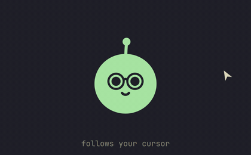
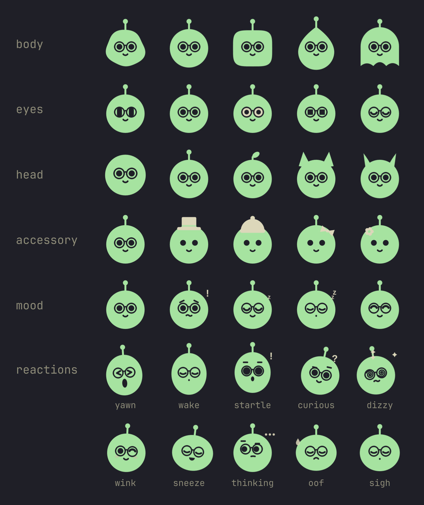
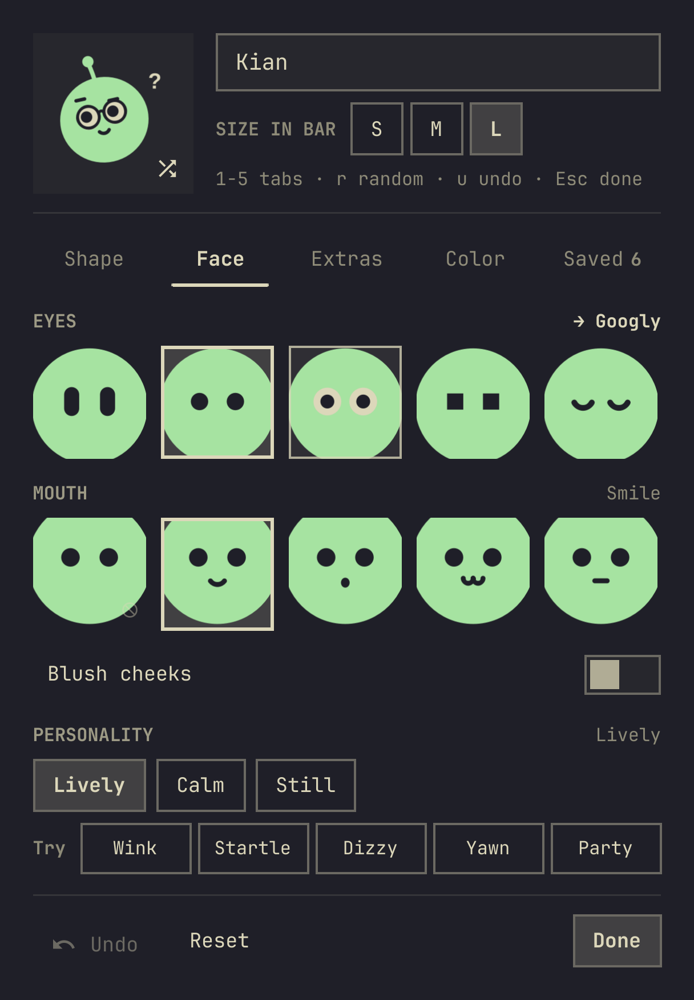
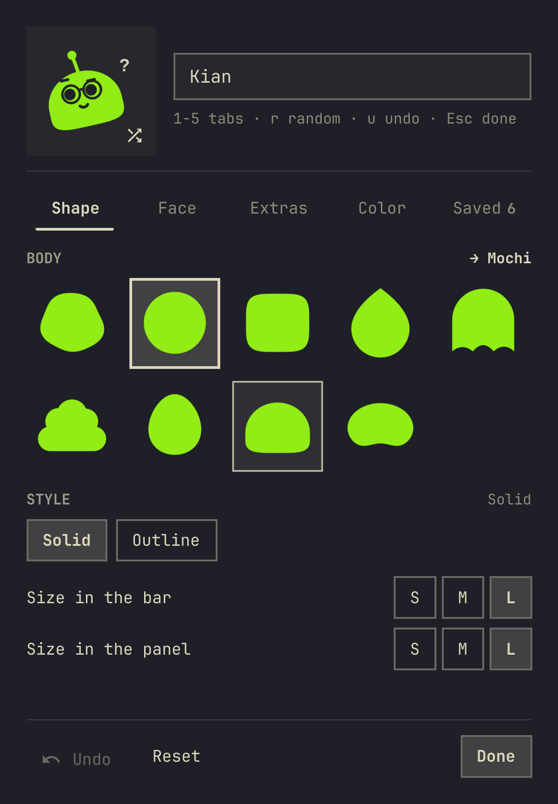
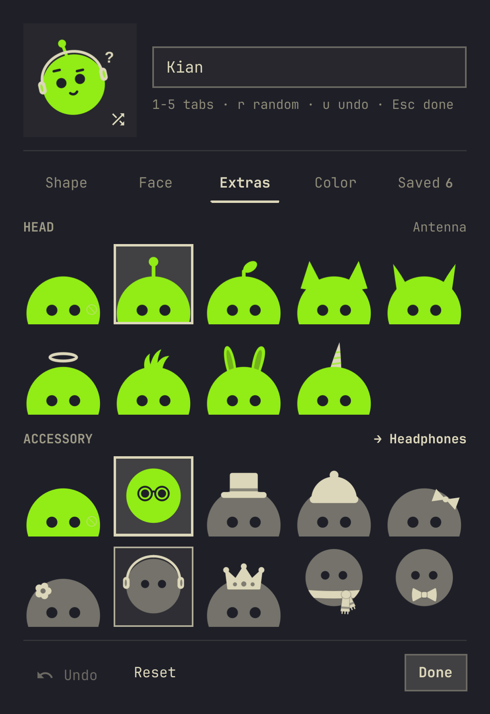
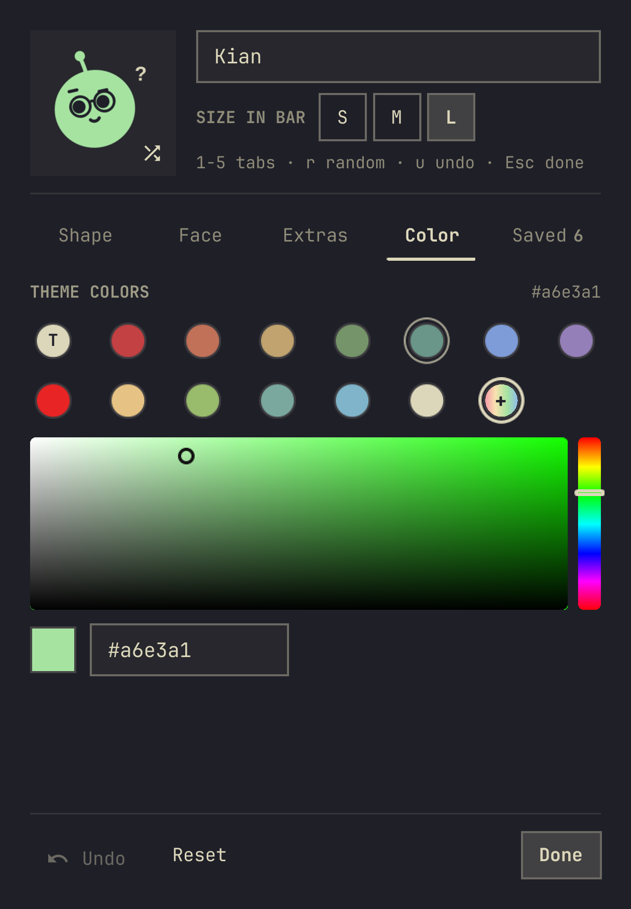
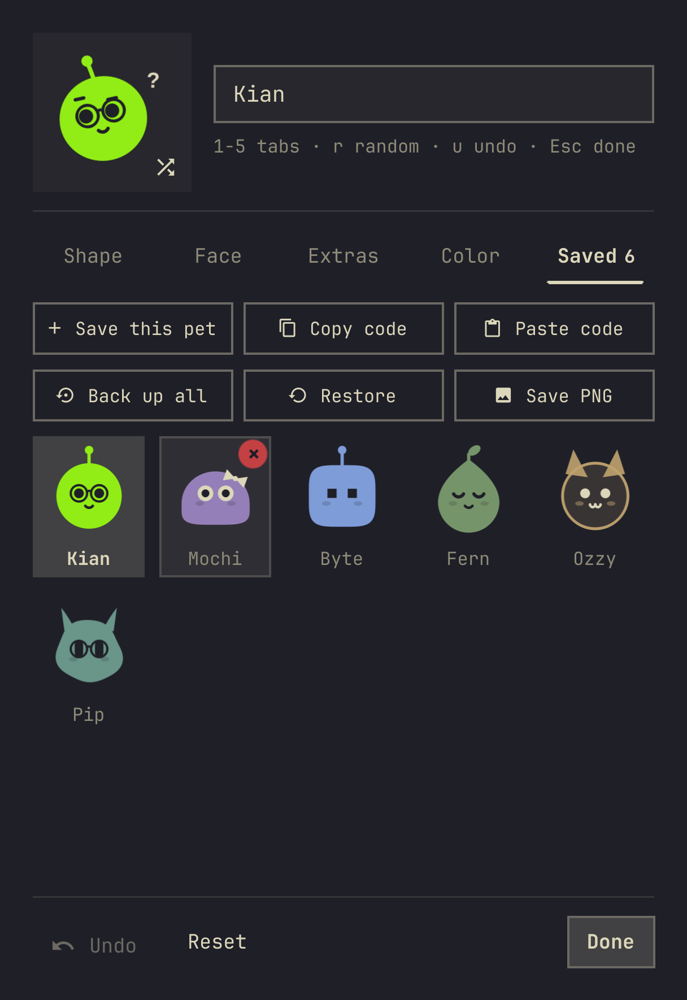

# Agents Pet

**Kian**: a small flat pet that lives in your [Omarchy](https://omarchy.org) bar and Agents
panel. It keeps you company while you work, follows your cursor around the screen, reacts to
your AI-agent limits (Claude, Codex, Antigravity, …) and shares calm usage tips. You can
reshape it however you like.

🇧🇷 [Leia em português](README.pt-BR.md)

<p align="center"></p>

> Built on top of Omarchy's stock **Agents** panel (MIT). Everything the stock panel does
> (limits, pace, balances, multi-account) is still here. The pet sits on top.

## What you get

- **A pet in your bar**: the bar icon is the pet itself, blinking quietly. Its size follows
  your bar height (S / M / L on top of that, set apart from the pet in the panel).
- **A living pet in the panel**: it breathes, blinks and, while the panel is open, follows
  your cursor anywhere on the screen. Click it to give it a pat: it squishes, smiles and lets
  a heart float up (a few pats in a row and it hops, too many make it dizzy). Leave the mouse
  still for a while and it yawns and dozes off (sooner late at night); move or pat it and it
  wakes with a stretch.
- **Small reactions**: it thinks while your usage refreshes, gets startled when the cursor
  rushes at it, tilts its head when the cursor rests nearby, winks hello, lets out an "oof"
  when a subscription hits its cap and a sigh when a limit stops being close. Now and then
  it sneezes or yawns. The bar pet only shows still poses, so it stays cheap.
- **Moods from your limits**: worried (raised brows, a little "!") when a limit is close,
  tired ("z") when every subscription is maxed out, and a small confetti party when one
  comes back. Its color never changes; the limit bars still turn red as usual.
- **Seasonal hats**: a Santa hat on Dec 24–25 and a party hat on Dec 31 / Jan 1.
- **One calm tip line** under the pet's name: live insights first (a limit near or at its
  cap with its reset time, a quieter subscription to switch to, tokens today and per session,
  a late-night nudge), then a pool of general tips for working with agents.
- **Pet Studio**: shape, face, extras, color, personality and saved pets, with backup and
  PNG export (see [Use](#use)).

<p align="center"></p>

The panel follows Omarchy's language setting: the stock panel strings ship in all 50
Omarchy languages, and the pet's own strings in English and Brazilian Portuguese.

## Install

```bash
omarchy plugin add https://github.com/gusthanks/omarchy-agents-pet.git --enable
```

Update with `omarchy plugin update gusthx.agents-pet`, and uninstall with
`omarchy plugin remove gusthx.agents-pet`. Removing the plugin leaves your pet in
`~/.config/omarchy/agents-pet.json`; delete that file too if you want it gone.

> [!NOTE]
> Agents Pet replaces the stock **Agents** bar widget. Keep only one of them in your bar.

**Tip:** a slightly taller bar suits the pet. Add this to `~/.config/omarchy/shell.toml`
(it applies to every theme):

```toml
[bar]
size-horizontal = 30
size-vertical = 32
```

## Use

Click the pet in the bar to open the panel. The tip under the pet's name is shown whole,
wrapped over a few lines; hovering it pauses the rotation, and the › button jumps to the
next one. Limit alerts are shown in red. Click the pet for a pat.

**Pet Studio**: click the gear in the panel header. A stage with the pet and a random
(shuffle) button and its name sit on top; five tabs below, and Undo / Reset / Done at the
bottom:

- **Shape**: body (blob, orb, squircle, drop, ghost, cloud, egg, mochi, bean), style
  (solid or outline), and the pet's size in the bar and in the panel (S / M / L each)
- **Face**: eyes (capsule, dots, googly, pixel, sleepy, star, sparkly, cyclops, heart),
  mouth (none, smile, surprised, cat, flat, fang, tongue, grin, smirk), the size of each
  (XS to XL), blush cheeks, and the **personality**: Lively (every reaction and little
  fidgets), Calm (reacts to you, no idle fidgets) or Still (poses only, no animated
  reactions); a **Try** row plays Wink, Startle, Dizzy, Yawn and Party (celebrate) on the
  stage
- **Extras**: head (antenna, leaf, cat ears, horns, halo, tuft, bunny ears, unicorn horn)
  and accessory (glasses, top hat, beanie, bow, flower, headphones, crown, scarf, bow tie)
- **Color**: your current theme's colors (they follow theme switches), or any color from
  the custom picker / a hex code; a **Recent** row keeps your last 8 custom colors (kept
  through Undo and Reset, and in backups)
- **Saved**: keep the pets you make (up to 24) and wear them again in one click; copy /
  paste a pet as a short JSON code; **Back up all** writes the current pet, saved pets,
  sizes, personality and recent colors to `agents-pet-backup.json` in your Documents folder (the XDG one,
  usually `~/Documents`, or `~/` when there is none) and **Restore** reads it back with
  the same checks as a pasted code; **Save PNG** saves the pet as a transparent 1024 px
  image `agents-pet-<name>.png` in your Pictures folder (XDG, usually `~/Pictures`)

Pointing at an option tries it on the stage; a click commits it. The shuffle button rolls a
random look, Reset goes back to the default, and Undo puts back the last random roll, reset,
worn, removed, pasted or restored pet. Changes apply live and are saved to
`~/.config/omarchy/agents-pet.json`.

<p align="center"></p>
<p align="center">&nbsp;&nbsp;&nbsp;</p>

**Keyboard** (in Pet Studio):

| Key | Action |
|---|---|
| Arrows / `h` `j` `k` `l` | Move between options |
| `Enter` | Pick |
| `1`–`5`, `[` `]` | Switch tabs |
| `r` | Random look |
| `u`, `Ctrl+Z` | Undo |
| `s` | Save the pet |
| `c` / `v` | Copy / paste a code |
| `e` | Edit the name |
| `x`, `Delete`, `Backspace` | Remove a saved pet |
| `Esc` | Step back (picker, then the editor, then the panel) |

**IPC** (`omarchy-shell gusthx.agents-pet <method>`): `open`, `close`, `show`, `hide`,
`toggle`, `refresh`, `nextInsight`, `editPet`, `pat`, `celebrate`, `react <name>` (pat, hop,
celebrate, yawn, wake, startle, curious, dizzy, wink, sneeze, thinking, oof, sigh).

## Configuration

| Where | What |
|---|---|
| Gear button in the panel | Pet look, name, size, personality and saved pets (`~/.config/omarchy/agents-pet.json`) |
| Widget settings / `shell.json` → `companionName` | Fallback name when the settings haven't set one |
| Widget settings / `shell.json` → `refreshIntervalSec`, `sync*` | Same as the stock Agents panel |

## Privacy

The pet adds no network calls. What it touches:

- `~/.config/omarchy/agents-pet.json` (your pet, saved pets, size and personality).
- The clipboard, only when you press **Copy code** / **Paste code** (`wl-copy` /
  `wl-paste`). The code holds only the pet's name and look; pasted codes are checked
  against the known options before use.
- `agents-pet-backup.json` in your Documents folder, only when you press **Back up all**
  (write) or **Restore** (read). Restored backups get the same checks as pasted codes.
- `agents-pet-<name>.png` in your Pictures folder, only when you press **Save PNG**.

Usage numbers come from Omarchy's own stock collectors (`omarchy-agent-usage-*`), the same
ones the stock Agents panel runs. They read each agent's local credential files (for example
`~/.claude/.credentials.json`, `~/.codex/auth.json`) and contact only that agent's own
provider API (Anthropic, OpenAI, GitHub, Cursor, Google, and so on). That code ships with
Omarchy and is not part of this repository.

## Development

Work in a clone **outside** the plugin folder and test in the isolated dev harness, so the
bar you are using is never reloaded while you work. See [AGENTS.md](AGENTS.md).

```bash
git clone https://github.com/gusthanks/omarchy-agents-pet.git ~/Work/omarchy-agents-pet
cd ~/Work/omarchy-agents-pet
dev/run.sh preview      # separate Quickshell instance with the pet and its settings
dev/run.sh editor face  # docs/editor-face.png (any tab: shape face extras color saved)
dev/run.sh png          # checks Save PNG, backup / restore and the editor's keys (temp folder)
dev/run.sh gif          # docs/demo.gif (about 12 s)
dev/run.sh docs         # regenerate every image in docs/
dev/run.sh check        # compile every type, Panel.qml included, and the usage/ libraries
dev/run.sh test         # Node tests of the usage math in usage/
omarchy plugin validate .
git commit -am "..."    # then, when it is done:
dev/deploy.sh           # fast-forward the installed plugin to HEAD
```

The captures read your own pet by default; set `PET_FILE=/path/to/agents-pet.json` to
render another one.

The repository root is the plugin folder, the layout `omarchy plugin add` expects:

```
manifest.json      plugin manifest (id gusthx.agents-pet)
Panel.qml          bar button + panel, insights, moods, pet wiring
BlobAvatar.qml     the pet (one Canvas, drawn from a "look" object and a "face")
PetFace.js         expression channels, named expressions, easing
PetClips.js        reactions as data (steps, priorities, cooldowns)
FacePlayer.qml     plays one reaction at a time over the mood / sleep pose
PetEditor.qml      pet settings: stage, tabs, try-on, undo, saved pets, backup, PNG
PetChip.qml        one framed option chip in the settings
ColorPicker.qml    saturation/value square + hue strip
ThemePalette.qml   reads the current theme's named colors
usage/             pure usage math (windows, pace, priority, notices), tested in dev/tests
UsageHistory.qml   keeps 25 h of fresh limit readings in ~/.local/state/omarchy/agents-pet/
Main.qml, Agent.qml, assets/   stock Agents plugin pieces
i18n/              strings (stock panel strings in 50 languages, pet strings en + pt-BR)
dev/               isolated harness (run.sh, Harness.qml), deploy.sh
docs/              images generated by dev/run.sh
```

## Changes

See [CHANGELOG.md](CHANGELOG.md).

## Credits

- Stock Agents panel (`Main.qml`, `Agent.qml`, `assets/`, the panel and collectors this
  plugin builds on): the [Omarchy](https://github.com/basecamp/omarchy) project, MIT,
  Copyright (c) David Heinemeier Hansson.
- Parametric pet idea inspired by the Hermes Agent mobile app's bot sculptor.
- Pacing, use-it-or-lose-it priority, limit notifications and notice parsing in `usage/`
  are ported from [ai-usagebar](https://github.com/akitaonrails/ai-usagebar), MIT,
  Copyright (c) 2026 AkitaOnRails.

## License

MIT. See [LICENSE](LICENSE).
