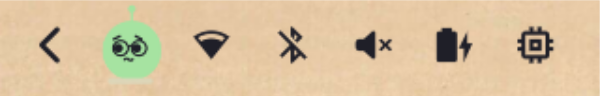

# Agents Pet

**Kian**: a small flat pet that lives in your [Omarchy](https://omarchy.org) bar and Agents
panel. It keeps you company while you work, follows your cursor around the screen, reacts to
your AI-agent limits (Claude, Codex, Antigravity, …) and shares calm usage tips. You can
reshape it however you like.

<p align="center"></p>
<p align="center"></p>

> Built on top of Omarchy's stock **Agents** panel (MIT). Everything the stock panel does
> (limits, pace, balances, multi-account) is still here. The pet sits on top.

## What you get

- **A pet in your bar**: the bar icon is the pet itself, blinking quietly. Its size follows
  your bar height.
- **A living pet in the panel**: it breathes, blinks and, while the panel is open, follows
  your cursor anywhere on the screen. Click it to give it a pat: it squishes, smiles and lets
  a heart float up (a few pats in a row and it hops). Leave the mouse still for a while and
  it dozes off (sooner late at night); move or pat it to wake it.
- **Moods from your limits**: worried (raised brows, a little "!") when a limit is close,
  tired ("z") when every subscription is maxed out, and a small confetti party when one
  comes back. Its color never changes; the limit bars still turn red as usual.
- **Seasonal hats**: a Santa hat on Dec 24–25 and a party hat on Dec 31 / Jan 1.
- **One calm tip banner**: live insights first (a limit near or at its cap with its reset
  time, a quieter subscription to switch to, tokens today and per session, a late-night
  nudge), then a pool of general tips for working with agents. It rotates slowly, pauses
  while you hover it, and the › button jumps to the next tip.
- **Pet settings**: click the gear in the panel header.
  - Size: small, medium, large (panel and bar)
  - Body: blob, orb, squircle, drop, ghost
  - Eyes: capsule, dot, googly, pixel, sleepy
  - Mouth: none, smile, o, cat, flat
  - Head: antenna, leaf, ears, horns
  - Accessory: glasses, top hat, beanie, bow, flower
  - Style: solid or outline, cheeks on or off
  - Color: your current theme's colors (they follow theme switches), or any color from the
    picker / a hex code
  - Name, 🎲 random, reset
  - **Saved pets**: keep the pets you make and wear them again in one click
  - **Copy / paste code**: share a pet as a short JSON code through the clipboard

  Changes apply live and are saved to `~/.config/omarchy/agents-pet.json`.

The panel follows Omarchy's language setting: the stock panel strings ship in all 50
Omarchy languages, and the pet's own strings in English and Brazilian Portuguese.

## Install

```bash
omarchy plugin add https://github.com/gusthanks/omarchy-agents-pet.git --enable
```

Update later with `omarchy plugin update gusthx.agents-pet`.

> [!NOTE]
> Agents Pet replaces the stock **Agents** bar widget. Keep only one of them in your bar.

**Tip:** a slightly taller bar suits the pet. Add this to `~/.config/omarchy/shell.toml`
(it applies to every theme):

```toml
[bar]
size-horizontal = 30
size-vertical = 32
```

## Configuration

| Where | What |
|---|---|
| Gear button in the panel | Pet look, name, size and saved pets (`~/.config/omarchy/agents-pet.json`) |
| Widget settings / `shell.json` → `companionName` | Fallback name when the settings haven't set one |
| Widget settings / `shell.json` → `refreshIntervalSec`, `sync*` | Same as the stock Agents panel |

IPC (`omarchy-shell gusthx.agents-pet <method>`): `open`, `close`, `show`, `hide`, `toggle`,
`refresh`, `nextInsight`, `editPet`, `pat`, `celebrate`.

## Privacy

The pet adds no network calls. What it touches:

- `~/.config/omarchy/agents-pet.json` (your pet), and the clipboard only when you press
  **Copy code** / **Paste code** (`wl-copy` / `wl-paste`). The code holds only the pet's name
  and look; pasted codes are checked against the known options before use.

Usage numbers come from Omarchy's own stock collectors (`omarchy-agent-usage-*`), the same
ones the stock Agents panel runs. They read each agent's local credential files (for example
`~/.claude/.credentials.json`, `~/.codex/auth.json`) and contact only that agent's own
provider API (Anthropic, OpenAI, GitHub, Cursor, Google, and so on). That code ships with
Omarchy and is not part of this repository.

## Repository layout

The repository root is the plugin folder, the layout `omarchy plugin add` expects.

```
manifest.json      plugin manifest (id gusthx.agents-pet)
Panel.qml          bar button + panel, insights, moods, pet wiring
BlobAvatar.qml     the pet (one Canvas, drawn from a "look" object)
PetEditor.qml      pet settings with live preview and saved pets
ColorPicker.qml    saturation/value square + hue strip
ThemePalette.qml   reads the current theme's named colors
Main.qml, Agent.qml, assets/   stock Agents plugin pieces
i18n/              strings (stock panel strings in 50 languages, pet strings en + pt-BR)
docs/              screenshots
```

## Development

Clone the repo straight into your plugin folder; the shell reloads on save:

```bash
git clone https://github.com/gusthanks/omarchy-agents-pet.git ~/.config/omarchy/plugins/gusthx.agents-pet
omarchy plugin validate ~/.config/omarchy/plugins/gusthx.agents-pet
```

If IPC changes don't show up after a hot reload, run `omarchy restart shell`
(never `omarchy refresh shell`, which resets your bar layout).

## Credits

- Stock Agents panel: the Omarchy project (MIT).
- Parametric pet idea inspired by the Hermes Agent mobile app's bot sculptor.

## License

MIT. See [LICENSE](LICENSE).
