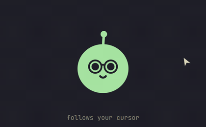
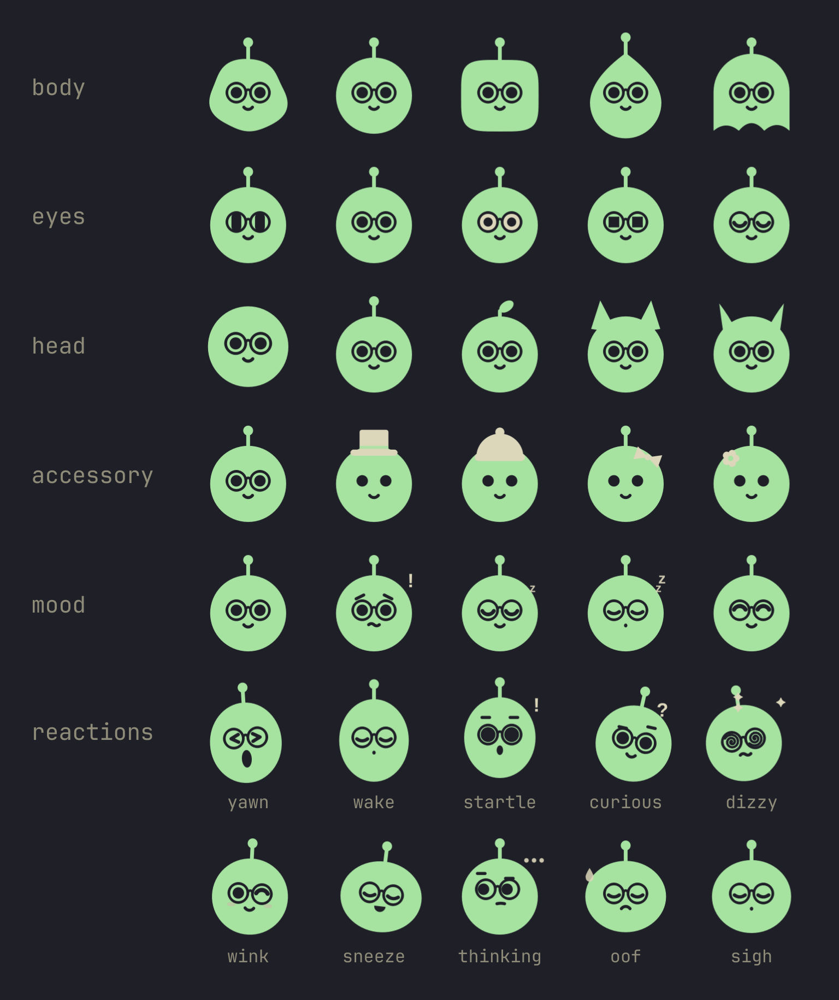
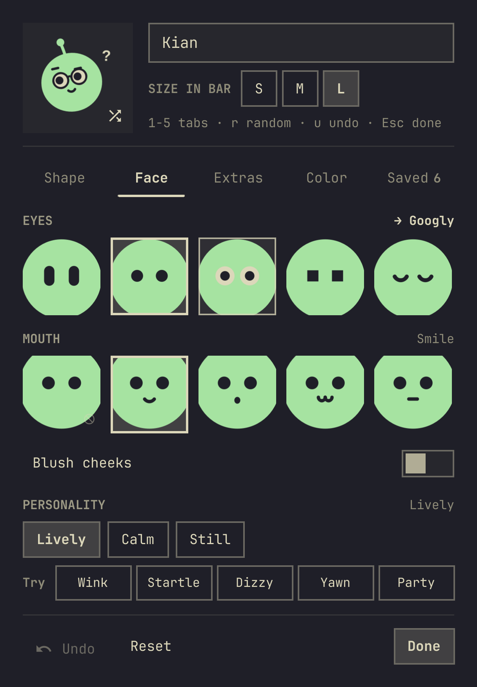
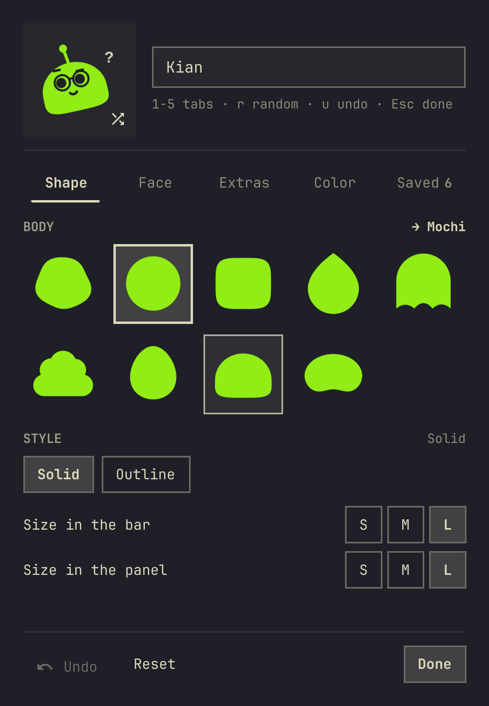
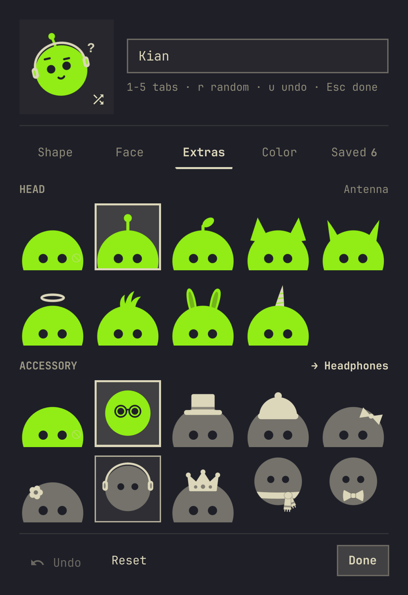
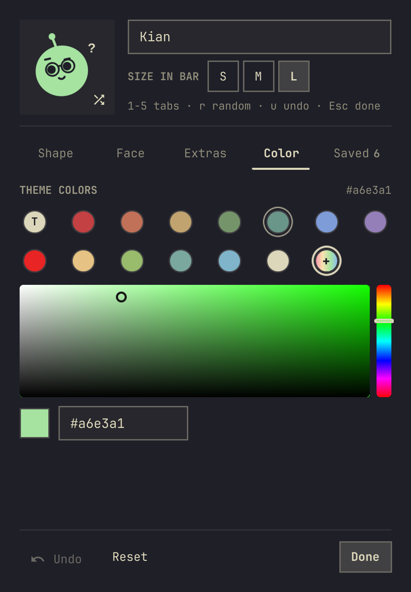
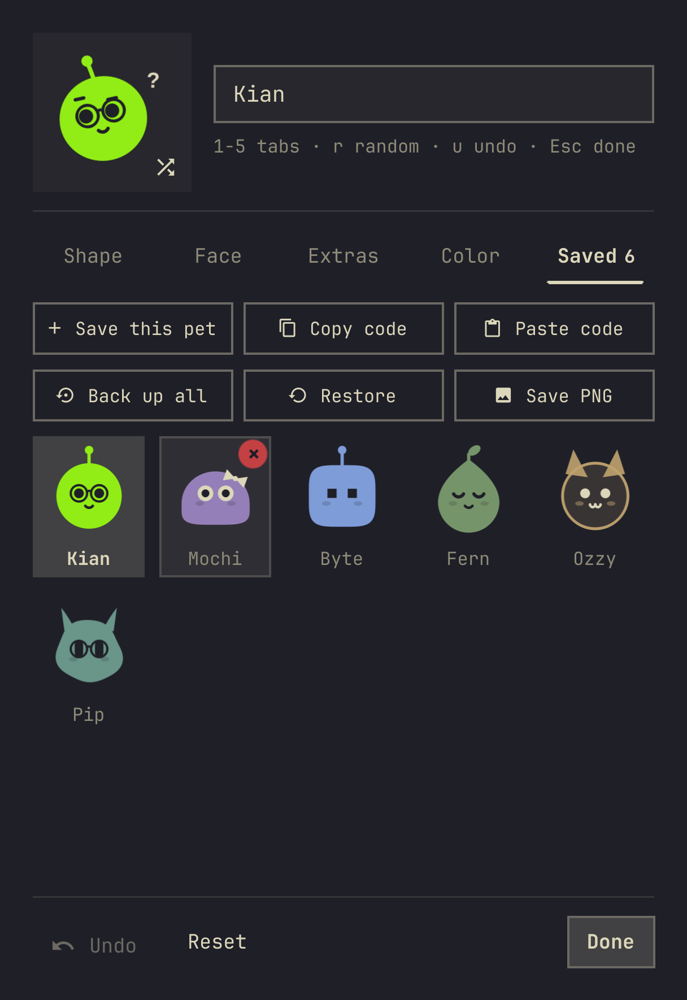

# Agents Pet

**Kian**: um bichinho plano que mora na barra do [Omarchy](https://omarchy.org) e no painel
Agents. Ele faz companhia enquanto você trabalha, segue o cursor pela tela, reage aos
limites dos seus agentes de IA (Claude, Codex, Antigravity, …) e dá dicas de uso com calma.
Você pode remodelá-lo do jeito que quiser.

🇺🇸 [Read in English](README.md)

<p align="center"></p>

> Feito sobre o painel **Agents** padrão do Omarchy (MIT). Tudo o que o painel padrão faz
> (limites, ritmo, saldos, várias contas) continua aqui. O bichinho fica por cima. O ritmo,
> o "Use primeiro", as notificações e a leitura dos avisos foram portados do
> [ai-usagebar](https://github.com/akitaonrails/ai-usagebar) (MIT).

## O que você ganha

- **Um bichinho na barra**: o ícone da barra é o próprio bichinho, piscando de leve. O
  tamanho acompanha a altura da barra (Pequeno / Médio / Grande por cima disso, separado
  do bichinho do painel).
- **Um bichinho vivo no painel**: ele respira, pisca e, com o painel aberto, segue o cursor
  em qualquer lugar da tela. Clique nele para fazer carinho: ele se espreme, sorri e solta
  um coração (alguns carinhos seguidos e ele pula; carinho demais deixa ele tonto). Deixe o
  mouse parado um tempo e ele boceja e cochila (mais cedo tarde da noite); mexa o mouse ou
  faça carinho e ele acorda se espreguiçando.
- **Pequenas reações**: ele pensa enquanto o uso atualiza, se assusta quando o cursor vem
  correndo, inclina a cabeça quando o cursor para perto, pisca um olá, solta um "ufa" quando
  uma assinatura bate no teto e um suspiro quando ele se acalma. De vez em
  quando espirra ou boceja. Na barra ele só mostra poses paradas, para ficar leve.
- **Humores pelos limites**: ofegante (boca aberta, bochechas coradas, uma gota de suor e
  baforadas) quando um limite está sendo gasto bem acima de um ritmo constante, preocupado
  (sobrancelhas levantadas, um "!") por dez minutos quando uma assinatura que você está
  usando passa de 90% (ou um saldo pré-pago que você está gastando chega aos últimos 10%),
  cansado ("z") quando todas as assinaturas estouraram, com fome (lambendo os beiços, uma
  gotinha de baba, garfo e faca) quando uma cota semanal está para reiniciar com boa parte
  sem uso, e uma festinha de confete quando uma volta. O Kian só se preocupa com o que te
  afeta, e só por um tempo: uma assinatura quase cheia que você não tocou nas últimas duas
  horas não conta, e a mesma janela só volta a preocupá-lo depois de cair abaixo de 83% ou
  reiniciar. A única preocupação que dura é não ter para onde ir: todas as assinaturas em
  90% ou mais. Cansado vence preocupado, que vence ofegante, que vence com fome. A cor dele
  nunca muda; as barras de limite, as dicas e as notificações continuam ficando vermelhas e
  avisando como sempre.
- **Avisos mais claros**: um agente que não pôde ser lido mostra um ícone do tipo de problema
  e uma mensagem legível ("Limite de requisições — tentando de novo em 4m" quando o tempo
  é conhecido). Se o aviso indica o comando de login de uma CLI de agente instalada
  (`cursor-agent login`, `claude auth login`, `kimi login`...), o botão **Resolver**
  (alcançável pelo teclado) o executa num terminal flutuante e atualiza os limites quando
  ele fecha. Só esses comandos de login são oferecidos: nunca outro subcomando, opção ou
  prompt, diga o aviso o que disser.
- **Notificações na área de trabalho**: quando um limite chega a 97% (`notifyThreshold`),
  o Kian manda um aviso tranquilo com o próprio rosto de ícone ("Claude: Semanal em 97%.
  Quase no limite. Volta em 1d 4h; bom momento pra trocar de agente."), um urgente quando
  esse limite depois estoura, e um lembrete quando uma redefinição gratuita do Codex expira
  em menos de 48 horas. Uma vez por vez que cruza: um limite só volta a avisar depois de
  cair 7 pontos abaixo do limiar ou começar uma janela nova, e nem reiniciar nem adicionar
  uma segunda conta repete um aviso. Leituras que já estavam no disco quando o plugin
  abriu ficam quietas. Na barra, o Kian dá um pulinho com um "!" quando um aviso sai, ou
  solta o "ufa" quando bate no teto.
- **Use primeiro**: quando uma das suas assinaturas reiniciaria com cota sobrando, uma
  lista curta acima dos agentes diz qual usar primeiro ("~60% da cota semanal ficaria sem
  uso; reinicia em 20h"), depois as outras: no ritmo (chega perto do teto bem no
  reinício), vai acabar (nesse ritmo, acaba em 2d 7h, antes de reiniciar) ou sem cota.
  Passe o mouse numa linha para ver os números por trás da posição; Enter ou um clique leva
  aos limites dela. Sem nada para usar primeiro, a seção não aparece.
- **Ritmo em cada limite**: um tracinho na cor de destaque onde o uso estaria num ritmo
  constante, uma seta ao lado da porcentagem (↑ acima, → no ritmo, ↓ abaixo; mostrando o
  que resta, a seta acompanha esse número, então um ritmo rápido aponta para baixo) e, ao
  passar o mouse, aonde esse ritmo leva ("bate no limite em 1d 9h", "sobra ~92% quando
  reiniciar").
- **Chapéus de época**: gorro de Papai Noel em 24–25/12 e chapéu de festa em 31/12 e 1/1.
- **Uma linha de dica tranquila** sob o nome do bichinho: primeiro as informações ao vivo
  (um limite perto ou no teto com o horário de renovação, um limite sendo gasto rápido demais
  e quando ele acabaria, uma cota prestes a ser desperdiçada ("Codex deixaria ~55% da
  cota semanal sem uso até reiniciar em 20h"), uma assinatura mais folgada para trocar, tokens hoje e por sessão,
  um lembrete tarde da noite), depois dicas gerais para trabalhar com agentes.
- **Pet Studio**: forma, rosto, extras, cor, personalidade e bichinhos salvos, com backup
  e exportação em PNG (veja [Uso](#uso)).

<p align="center"></p>

O painel segue o idioma do Omarchy: os textos do painel padrão vêm nas 50 línguas do
Omarchy, e os do bichinho em inglês e português do Brasil.

## Instalação

```bash
omarchy plugin add https://github.com/gusthanks/omarchy-agents-pet.git --enable
```

Atualize com `omarchy plugin update gusthx.agents-pet` e desinstale com
`omarchy plugin remove gusthx.agents-pet`. Remover o plugin mantém seu bichinho em
`~/.config/omarchy/agents-pet.json`; apague esse arquivo também se quiser.

> [!NOTE]
> O Agents Pet substitui o widget **Agents** padrão da barra. Deixe só um dos dois na barra.

**Dica:** uma barra um pouco mais alta combina com o bichinho. Coloque isto em
`~/.config/omarchy/shell.toml` (vale para todos os temas):

```toml
[bar]
size-horizontal = 30
size-vertical = 32
```

## Uso

Clique no bichinho na barra para abrir o painel. A dica sob o nome aparece inteira, em
algumas linhas; passar o mouse por cima pausa a troca, e o botão › pula para a próxima.
Alertas de limite aparecem em vermelho. Clique no bichinho para fazer carinho.

**Pet Studio**: clique na engrenagem no topo do painel. Em cima ficam um palco com o
bichinho, um botão de sorteio e o nome; embaixo, cinco abas, e Desfazer / Restaurar /
Pronto no rodapé:

- **Forma**: corpo (bolha, orbe, quadradinho, gota, fantasma, nuvem, ovo, mochi, feijão),
  estilo (sólido ou contorno) e o tamanho do bichinho na barra e no painel (Pequeno /
  Médio / Grande, cada um)
- **Rosto**: olhos (cápsula, pontinhos, esbugalhados, pixel, sonolentos, estrela,
  brilhante, ciclope, coração), boca (nenhuma, sorriso, surpresa, gatinho, reta, presinha,
  língua, sorrisão, sorriso de lado), o tamanho de cada um (Bem pequeno a Bem grande),
  bochechas coradas e a **personalidade**: Animado (todas
  as reações e pequenas manias), Calmo (reage a você, sem manias à toa) ou Quieto
  (só poses, sem reações animadas); uma linha **Testar** toca Piscar, Susto, Tontura,
  Bocejo e Festa no palco
- **Extras**: cabeça (antena, folha, orelhas de gato, chifres, auréola, topete, orelhas de
  coelho, chifre de unicórnio) e acessório (óculos, cartola, gorro, laço, flor, fone de
  ouvido, coroa, cachecol, gravata-borboleta)
- **Cor**: as cores do tema atual (acompanham a troca de tema), ou qualquer cor do seletor
  ou de um código hex; uma linha **Recentes** guarda as últimas 8 cores personalizadas
  (continuam lá depois de Desfazer e Restaurar, e vão junto no backup)
- **Salvos**: guarde os bichinhos que criar (até 24) e use de novo com um clique; copie /
  cole um bichinho como um código JSON curto; **Backup** grava o bichinho
  atual, os salvos, os tamanhos, a personalidade e as cores recentes em `agents-pet-backup.json` na sua pasta
  Documentos (a do XDG, normalmente `~/Documents`, ou `~/` se não houver) e **Restaurar**
  lê de volta com as mesmas verificações de um código colado; **Salvar PNG** salva o
  bichinho como imagem transparente de 1024 px `agents-pet-<nome>.png` na sua pasta
  Imagens (XDG, normalmente `~/Pictures`)

Apontar para uma opção experimenta ela no palco; um clique confirma. O sorteio gera um
visual aleatório, Restaurar (no rodapé) volta ao padrão, e Desfazer devolve o último sorteio,
redefinição, bichinho vestido, removido, colado ou restaurado. As mudanças valem na hora e
ficam salvas em `~/.config/omarchy/agents-pet.json`.

<p align="center"></p>
<p align="center">&nbsp;&nbsp;&nbsp;</p>

As imagens mostram a interface em inglês; com o Omarchy em português ela aparece traduzida.

**Teclado** (no Pet Studio):

| Tecla | Ação |
|---|---|
| Setas / `h` `j` `k` `l` | Andar entre as opções |
| `Enter` | Escolher |
| `1`–`5`, `[` `]` | Trocar de aba |
| `r` | Visual aleatório |
| `u`, `Ctrl+Z` | Desfazer |
| `s` | Salvar o bichinho |
| `c` / `v` | Copiar / colar um código |
| `e` | Editar o nome |
| `x`, `Delete`, `Backspace` | Remover um bichinho salvo |
| `Esc` | Voltar um nível (seletor, depois o editor, depois o painel) |

**IPC** (`omarchy-shell gusthx.agents-pet <método>`): `open`, `close`, `show`, `hide`,
`toggle`, `refresh`, `nextInsight`, `editPet`, `pat`, `celebrate`, `react <nome>` (pat, hop,
celebrate, yawn, wake, startle, curious, dizzy, wink, sneeze, thinking, oof, alert, sigh).

## Configuração

| Onde | O quê |
|---|---|
| Engrenagem no painel | Visual, nome, tamanho, personalidade e salvos (`~/.config/omarchy/agents-pet.json`) |
| Ajustes do widget / `shell.json` → `companionName` | Nome reserva quando os ajustes não definem um |
| Ajustes do widget / `shell.json` → `refreshIntervalSec`, `sync*` | Igual ao painel Agents padrão |
| Ajustes do widget / `shell.json` → `showAs` | `Used` (padrão) ou `Left` (maiúsculas ou minúsculas): se as barras e porcentagens de limite mostram o usado ou o que resta. Os alertas seguem o usado |
| Ajustes do widget / `shell.json` → `colorCodeUsage` | `true` pinta as barras de verde → amarelo → laranja → vermelho, com as cores do tema, conforme o uso sobe (padrão `false`) |
| Ajustes do widget / `shell.json` → `showPace` | `false` esconde o tracinho, a seta e a projeção do ritmo (padrão `true`) |
| Ajustes do widget / `shell.json` → `showPriorities` | `false` esconde o "Use primeiro" (padrão `true`). Aparece enquanto alguma assinatura ficaria com cota sobrando |
| Ajustes do widget / `shell.json` → `recentHours` | Horas de uso recente que a previsão pesa contra a média do ciclo, de 1 a 24 (padrão `3`) |
| Ajustes do widget / `shell.json` → `alertUnusedPercent`, `alertHours` | Uma cota fica urgente quando pelo menos essa parte ficaria sem uso (padrão `50`) e ela reinicia dentro dessas horas (padrão `24`) |
| Ajustes do widget / `shell.json` → `priorityMood` | `false` impede o bichinho de ficar com fome por uma cota urgente (padrão `true`) |
| Ajustes do widget / `shell.json` → `notifications`, `notifyThreshold` | `false` desliga as notificações (padrão `true`); a parte usada, de 50 a 100, em que um limite avisa (padrão `97`), com mais um, urgente, quando ele estoura |
| Ajustes do widget / `shell.json` → `moodWindow` | `Auto` (padrão), `Session` ou `Weekly` (maiúsculas ou minúsculas): os limites que podem deixar o bichinho preocupado (ao passar de 90% enquanto em uso, ou todos em 90%) ou ofegante. Um provedor sem esse tipo continua valendo por todos os seus; cansado sempre quer dizer todas as assinaturas no teto |

## Privacidade

O bichinho não faz nenhuma chamada de rede. O que ele usa:

- `~/.config/omarchy/agents-pet.json` (seu bichinho, os salvos, tamanho e personalidade).
- A área de transferência, só quando você aperta **Copiar código** / **Colar código**
  (`wl-copy` / `wl-paste`). O código guarda só o nome e o visual; códigos colados são
  conferidos contra as opções conhecidas antes de usar.
- `agents-pet-backup.json` na pasta Documentos, só quando você aperta **Backup** (grava) ou **Restaurar** (lê). Backups restaurados passam pelas mesmas
  verificações dos códigos colados.
- `agents-pet-<nome>.png` na pasta Imagens, só quando você aperta **Salvar PNG**.
- `~/.local/state/omarchy/agents-pet/usage-history.json`: as últimas 25 horas de leituras
  de limite (janela, porcentagem, horário de renovação) com que o "Use primeiro" mede seu
  ritmo recente e o bichinho sabe quais assinaturas estão em uso.
- `~/.local/state/omarchy/agents-pet/mood-state.json`: com quais janelas de limite (e
  saldos pré-pagos) o bichinho já se preocupou e quando, o horário da última leitura de
  cada fonte e o último valor de cada saldo, para ele não se preocupar de novo depois de
  reiniciar.
- `~/.local/state/omarchy/agents-pet/notify-state.json`: quais janelas de limite e
  redefinições já foram avisadas, e o horário da última leitura de cada fonte, para nunca
  repetir um aviso; e `~/.cache/omarchy/agents-pet/kian-icon.png`, o bichinho desenhado
  como ícone dos avisos. Nenhum dos dois é mantido com `notifications` desligado.

Os números de uso vêm dos coletores padrão do próprio Omarchy (`omarchy-agent-usage-*`),
os mesmos que o painel Agents padrão roda. Eles leem os arquivos de credencial locais de
cada agente (por exemplo `~/.claude/.credentials.json`, `~/.codex/auth.json`) e falam só
com a API do próprio provedor (Anthropic, OpenAI, GitHub, Cursor, Google etc.). Esse código
vem com o Omarchy e não faz parte deste repositório.

## Desenvolvimento

Trabalhe num clone **fora** da pasta do plugin e teste no ambiente isolado, para a barra
que você está usando nunca recarregar no meio do trabalho. Veja o [AGENTS.md](AGENTS.md)
(em inglês).

```bash
git clone https://github.com/gusthanks/omarchy-agents-pet.git ~/Work/omarchy-agents-pet
cd ~/Work/omarchy-agents-pet
dev/run.sh preview      # instância separada do Quickshell com o bichinho e os ajustes
dev/run.sh editor face  # docs/editor-face.png (qualquer aba: shape face extras color saved)
dev/run.sh png          # testa Salvar PNG, backup / restauração e as teclas (pasta temporária)
dev/run.sh gif          # docs/demo.gif (uns 12 s)
dev/run.sh docs         # gera de novo todas as imagens de docs/
dev/run.sh check        # compila todos os tipos, inclusive o Panel.qml, e as bibliotecas de usage/
dev/run.sh test         # testes em Node das contas de uso em usage/
omarchy plugin validate .
git commit -am "..."    # e, quando terminar:
dev/deploy.sh           # avança o plugin instalado até o HEAD
```

As capturas usam o seu próprio bichinho por padrão; use
`PET_FILE=/caminho/agents-pet.json` para renderizar outro.

A raiz do repositório é a pasta do plugin, o formato que o `omarchy plugin add` espera.
Os arquivos estão descritos na seção
[Development do README em inglês](README.md#development).

## Mudanças

Veja o [CHANGELOG.md](CHANGELOG.md) (em inglês).

## Créditos

- Painel Agents padrão (`Main.qml`, `Agent.qml`, `assets/`, o painel e os coletores em que
  este plugin se baseia): o projeto [Omarchy](https://github.com/basecamp/omarchy), MIT,
  Copyright (c) David Heinemeier Hansson.
- Ideia do bichinho paramétrico inspirada no escultor de robôs do app móvel Hermes Agent.
- O ritmo, a prioridade de "use ou perca", os avisos de limite, a leitura dos avisos e as
  opções de exibição dos limites (usado / restante, faixas de cor, a janela do humor) em
  `usage/`, os motivos e detalhes do "Use primeiro" em `Panel.qml` e a entrega dos avisos
  em `Notifier.qml` foram portados do [ai-usagebar](https://github.com/akitaonrails/ai-usagebar), MIT,
  Copyright (c) 2026 AkitaOnRails.

## Licença

MIT. Veja a [LICENSE](LICENSE).
